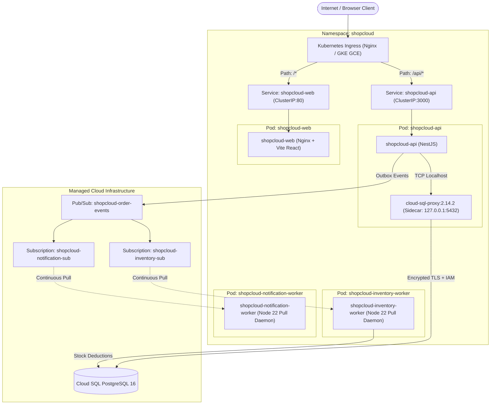

# ShopCloud Kubernetes Target Architecture & Workload Design

## 1. Overview

Phase 17 establishes the target Kubernetes architecture for the ShopCloud platform. The architecture is engineered for deployment on Google Kubernetes Engine (GKE) or local development clusters (Kind / Minikube), maintaining full architectural parity with the existing Google Cloud Run production deployment.

The system decouples synchronous customer HTTP traffic from asynchronous event processing while preserving relational ACID invariants and transactional outbox guarantees.

---

## 2. Workload & Network Topology

---

## 3. Workload Breakdown

### 3.1 `shopcloud-web` (Frontend Storefront)
- **Runtime**: Nginx Alpine serving compiled Vite React static assets.
- **Port**: Ingress listens on port 80; container port 8080.
- **Replicas**: 2 (HPA: 2-4).
- **Probes**: `/health` liveness and readiness probes.
- **Security**: Non-privileged container, dropped capabilities, ephemeral emptyDir volumes for cache and logs.

### 3.2 `shopcloud-api` (Core API Gateway)
- **Runtime**: Node.js 22 LTS on Debian Bookworm Slim running NestJS.
- **Port**: Internal ClusterIP port 3000.
- **Replicas**: 2 (HPA: 2-5).
- **Probes**:
  - Startup probe: `/api/v1/health/liveness` (initialDelay: 5s, period: 3s).
  - Liveness probe: `/api/v1/health/liveness` (period: 10s).
  - Readiness probe: `/api/v1/health/readiness` (period: 5s).
- **Security**: Runs as unprivileged `node` user (UID 1000), `readOnlyRootFilesystem: true`, capabilities dropped `ALL`.
- **Database Access**: Communicates with Google Cloud SQL via `cloud-sql-proxy` sidecar over `127.0.0.1:5432` using Workload Identity Federation for GKE.

### 3.3 `shopcloud-inventory-worker` (Inventory Consumer)
- **Runtime**: Node.js 22 LTS running the asynchronous consumer daemon in `PUBSUB_DELIVERY=pull` mode.
- **Subscription**: Dedicated subscription `shopcloud-inventory-sub`.
- **Ingress**: None (Private background consumer).
- **Health Probes**: Internal HTTP port 8081 (`/health`).
- **Graceful Shutdown**: Intercepts `SIGTERM`, ceases message pulls, drains in-flight inventory reservations within 10s, closes database connections, and exits cleanly.

### 3.4 `shopcloud-notification-worker` (Notification Consumer)
- **Runtime**: Node.js 22 LTS consumer daemon in `PUBSUB_DELIVERY=pull` mode.
- **Subscription**: Dedicated subscription `shopcloud-notification-sub`.
- **Ingress**: None (Private background consumer).
- **Health Probes**: Internal HTTP port 8081 (`/health`).
- **Graceful Shutdown**: Intercepts `SIGTERM`, drains in-flight notification tasks, and releases database connections.

---

## 4. Workload Identity & Security Boundaries

Under GKE, service accounts use Workload Identity:
- `shopcloud-api-ksa` binds to Google Service Account `shopcloud-api@project-c3f386b1-6c37-468d-8ee.iam.gserviceaccount.com`.
- `shopcloud-worker-ksa` binds to Google Service Account `shopcloud-worker@project-c3f386b1-6c37-468d-8ee.iam.gserviceaccount.com`.
- No Google Service Account JSON keys are stored or mounted into any container filesystem.
