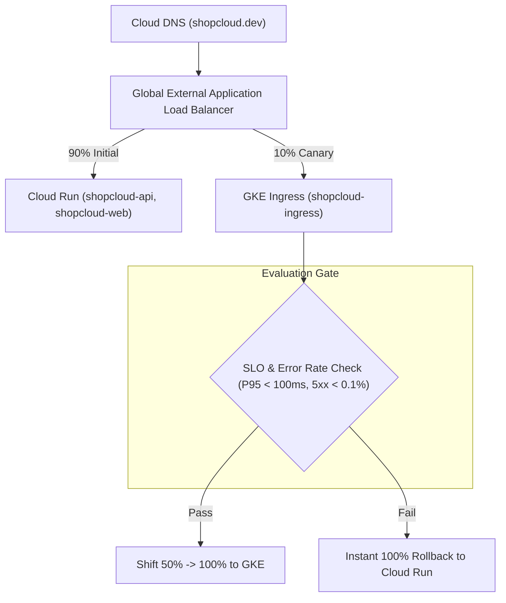

# ShopCloud Cloud Run to GKE Migration & Rollback Runbook

## 1. Migration Overview

ShopCloud currently runs in production on **Google Cloud Run (v2)**. This document specifies the operational procedure for migrating production workloads to Google Kubernetes Engine (GKE) safely without service interruption, and details an instant rollback mechanism to return traffic to Cloud Run if anomalies arise.

> [!IMPORTANT]
> Cloud Run remains the active production runtime. No live traffic is migrated, and no GKE cluster is provisioned during Phase 17 without explicit stakeholder approval.

---

## 2. Pre-Migration Verification Checklist

Before routing any production traffic to GKE:

1. **Artifact Parity**: Container images in Google Artifact Registry must pass automated vulnerability scans and SHA256 digest validation.
2. **Database Capacity & Headroom**: Cloud SQL connection pooling must be validated. Total connections from Cloud Run + GKE API pods + Worker pods must not exceed the database ceiling (`max_connections = 100`).
3. **Workload Identity Verified**: GKE Service Accounts (`shopcloud-api-ksa`, `shopcloud-worker-ksa`) must successfully exchange OIDC tokens for Google Service Account credentials.
4. **Secret Manager Synced**: All required production secrets (JWT secrets, DB credentials, Webhook keys) are accessible via Workload Identity.
5. **Observability Parity**: Cloud Monitoring dashboards, log sinks, and SLO alerting policies from Phase 14 are configured to monitor GKE workloads.

---

## 3. Staged Traffic Migration Strategy



### Stage 1: Parallel Deployment (0% Ingress Traffic)
- Deploy API and Web pods to GKE with staging overlay.
- Execute synthetic health and catalog smoke tests against GKE internal IP / staging domain.
- Confirm zero error logs and healthy probes.

### Stage 2: Canary Routing (10% Traffic)
- Using Cloud Load Balancing weighted backend services, route 10% of HTTP traffic to the GKE ingress endpoint and 90% to Cloud Run.
- Observe latency (P95), error rate (5xx), and database connection metrics for a minimum of 2 hours.

### Stage 3: Full Cutover (100% Traffic)
- Shift 100% of user traffic to GKE.
- Cut over worker subscriptions:
  - Worker processes implement durable idempotency in the `ProcessedEvent` table. Even if both Cloud Run workers and GKE workers process messages concurrently during cutover, duplicate events are safely ignored (`[IDEMPOTENT_SKIP]`).
  - Scale Cloud Run worker min-instances to 0 and disable push subscriptions.

---

## 4. Rapid Rollback Procedure

If severe regressions, elevated latency, or memory exhaustion occur on GKE:

### Step 1: Immediate Ingress Shift (< 60 Seconds)
In Google Cloud Console or via gcloud:
```bash
# Shift 100% traffic back to Cloud Run backend service
gcloud compute backend-services update shopcloud-api-backend \
  --global \
  --set-traffic-distribution=CLOUD_RUN=1.0,GKE=0.0
```

### Step 2: Reinstate Cloud Run Workers
If push subscriptions were modified, re-enable the Cloud Run push endpoint:
```bash
gcloud pubsub subscriptions update shopcloud-inventory-sub \
  --push-endpoint="https://shopcloud-worker-24903284190.asia-south1.run.app/pubsub/push"
```

### Step 3: Quiesce GKE Workloads
Scale GKE deployments to zero to prevent resource waste or database locks:
```bash
kubectl scale deployment --all -n shopcloud --replicas=0
```

---

## 5. Go / No-Go Decision Criteria

| Metric / Check | Go Threshold | No-Go / Rollback Trigger |
|---|---|---|
| **P95 API Latency** | $\le 100\text{ ms}$ (Catalog), $\le 500\text{ ms}$ (Checkout) | $> 250\text{ ms}$ sustained over 5 minutes |
| **HTTP 5xx Error Rate** | $< 0.1\%$ | $\ge 0.5\%$ over 3 consecutive minutes |
| **Cloud SQL Connections** | $< 50\text{ active connections}$ | $\ge 80\text{ active connections}$ |
| **Outbox Dispatch Lag** | $< 10\text{ seconds}$ | $\ge 60\text{ seconds}$ |
| **Worker In-Flight Drain** | Drains within $10\text{ seconds}$ on SIGTERM | Forced exit / SIGKILL observed in logs |
