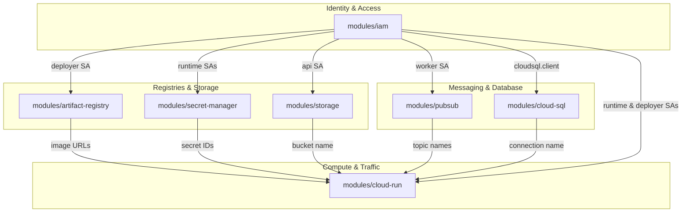

# ShopCloud Terraform Infrastructure as Code (IaC) Architecture

## 1. Overview & Architectural Principles

ShopCloud manages its Google Cloud Platform infrastructure through modular, version-controlled HashiCorp Terraform (`>= 1.5.0`, provider `hashicorp/google ~> 5.30`). The infrastructure as code design guarantees reproducible environments, deterministic deployments, transparent auditability, and strict adherence to ShopCloud's zero-cost cloud policy.

```
                                  ┌────────────────────────┐
                                  │      ShopCloud Git     │
                                  │   (Version Controlled) │
                                  └───────────┬────────────┘
                                              │
                                              ▼
                                 ┌──────────────────────────┐
                                 │   Terraform Dev Root     │
                                 │ (environments/dev/*.tf)  │
                                 └────────────┬─────────────┘
                                              │
         ┌──────────────────┬─────────────────┼─────────────────┬──────────────────┐
         ▼                  ▼                 ▼                 ▼                  ▼
  ┌─────────────┐    ┌─────────────┐   ┌─────────────┐   ┌─────────────┐    ┌─────────────┐
  │ modules/iam │    │ modules/    │   │ modules/    │   │ modules/    │    │ modules/    │
  │ - SAs       │    │ storage     │   │ pubsub      │   │ cloud-sql   │    │ cloud-run   │
  │ - WIF Pool  │    │ - Media GCS │   │ - Topics    │   │ - Postgres  │    │ - API v2    │
  │ - Bindings  │    │ - Lifecycle │   │ - Worker Sub│   │ - NEVER act │    │ - Web v2    │
  └─────────────┘    └─────────────┘   └─────────────┘   └─────────────┘    └─────────────┘
```

The architecture adheres to five foundational principles:

1. **Strict Zero-Cost Infrastructure Policy ($0 / ₹0 avoidable spend)**:
   - Cloud SQL instance `shopcloud-postgres` is strictly pinned to `activation_policy = "NEVER"`.
   - No Serverless VPC Access Connector is provisioned. Cloud Run communicates with Cloud SQL natively through the Unix domain socket sidecar proxy (`run.googleapis.com/cloudsql-instances`), eliminating continuous compute costs (~$10/month saved).
   - Compute services scale to zero (`min_instance_count = 0`).
2. **Separation of Concerns via Domain Modules**:
   - Infrastructure is partitioned into self-contained domain modules (`iam`, `artifact-registry`, `secret-manager`, `storage`, `pubsub`, `cloud-sql`, `cloud-run`).
   - Modules accept explicit variables and produce outputs consumed downstream, enforcing unidirectional dependency flow without circular references.
3. **Immutability and Separation of Secret Payloads**:
   - Terraform manages Secret Manager resource definitions and IAM access bindings only. Secret payloads (passwords, JWT keys) are never injected into Terraform configuration or state files.
4. **Least-Privilege Security Boundaries**:
   - Dedicated service accounts isolate each workload: `shopcloud-api-runtime`, `shopcloud-web-runtime`, `shopcloud-worker-runtime`, and `shopcloud-github-deployer`.
   - Deployer operations use Google Cloud Workload Identity Federation (WIF) with cryptographic OIDC validation; no service account keys exist.
5. **Deterministic State & Approval-Gated Mutation**:
   - All proposed infrastructure changes require dry-run review (`terraform plan`). Automated unattended `apply` operations are strictly forbidden.

---

## 2. Directory Structure & Monorepo Layout

Terraform configuration resides in the canonical repository location `infrastructure/terraform/`:

```
infrastructure/terraform/
├── environments/
│   └── dev/
│       ├── locals.tf               # Environment-level constants & tags
│       ├── main.tf                 # Root module orchestrating domain submodules
│       ├── outputs.tf              # Consolidates critical resource identifiers & URLs
│       ├── providers.tf            # Google provider configuration
│       ├── terraform.tfvars.example# Documented variable assignment template
│       ├── variables.tf            # Input variable declarations & type constraints
│       └── versions.tf             # Terraform & provider version constraints
└── modules/
    ├── artifact-registry/          # Container registry & deployer push IAM
    │   ├── main.tf
    │   ├── outputs.tf
    │   └── variables.tf
    ├── cloud-run/                  # Cloud Run v2 services (API & Web) & invoker IAM
    │   ├── main.tf
    │   ├── outputs.tf
    │   └── variables.tf
    ├── cloud-sql/                  # Cloud SQL PostgreSQL 16 (activation NEVER) & DB
    │   ├── main.tf
    │   ├── outputs.tf
    │   └── variables.tf
    ├── iam/                        # Service accounts, WIF pool/provider, & roles
    │   ├── main.tf
    │   ├── outputs.tf
    │   └── variables.tf
    ├── pubsub/                     # Domain topics, DLQs, worker subscriptions, & retry
    │   ├── main.tf
    │   ├── outputs.tf
    │   └── variables.tf
    ├── secret-manager/             # Secret metadata & runtime accessor IAM
    │   ├── main.tf
    │   ├── outputs.tf
    │   └── variables.tf
    └── storage/                    # Durable media GCS bucket, UBLA, PAP, & lifecycle
        ├── main.tf
        ├── outputs.tf
        └── variables.tf
```

---

## 3. Dependency Graph & Module Hierarchy

Terraform evaluates modules according to their dependency graph. Resources with no upstream dependencies (IAM, Storage, Artifact Registry) are instantiated first, followed by messaging and data, with compute services provisioned last:



---

## 4. Live GCP Infrastructure Mapping

All modules in `infrastructure/terraform/` reflect the actual configurations running in GCP project `project-c3f386b1-6c37-468d-8ee` (`asia-south1`):

| Module | Managed Resource | Resource Name / ID | Key Configuration Attributes |
| :--- | :--- | :--- | :--- |
| **`iam`** | Service Accounts | `shopcloud-api-runtime`<br>`shopcloud-web-runtime`<br>`shopcloud-worker-runtime`<br>`shopcloud-github-deployer` | Least-privilege roles; deployer granted `run.developer`, `artifactregistry.writer`, `iam.serviceAccountUser`. |
| **`iam`** | Workload Identity Federation | Pool: `shopcloud-github-pool`<br>Provider: `github-actions` | Issuer: `https://token.actions.githubusercontent.com`<br>Attribute condition: repo ID `1401646031`. |
| **`artifact-registry`** | Docker Repository | `shopcloud` | Format: `DOCKER`, location: `asia-south1`, mode: `STANDARD_REPOSITORY`. |
| **`secret-manager`** | Secrets (Metadata only) | `shopcloud-dev-database-url`<br>`shopcloud-dev-jwt-access-secret`<br>`shopcloud-dev-jwt-refresh-secret` | User-managed replication in `asia-south1`. Secret payloads managed outside Terraform. |
| **`storage`** | GCS Media Bucket | `shopcloud-media-24903284190` | Storage Class: `STANDARD`, location: `asia-south1`, UBLA: `true`, PAP: `enforced`, Soft delete: 7 days, Multipart abort: 7 days. |
| **`pubsub`** | Topics & DLQs | `shopcloud-domain-events`<br>`shopcloud-inventory-dlq`<br>`shopcloud-notification-dlq` | Message retention: 7 days (604800s). Service agent granted publisher permission on DLQs. |
| **`pubsub`** | Subscriptions | `shopcloud-inventory-sub`<br>`shopcloud-notification-sub`<br>Operator DLQ subscriptions | Ack deadline: 30s, message ordering enabled on inventory sub, dead-letter policy: 5 delivery attempts, backoff: 10s–600s. |
| **`cloud-sql`** | PostgreSQL Instance | `shopcloud-postgres` | PostgreSQL 16, tier: `db-custom-1-3840`, storage: 10GB SSD (autoresize enabled), **`activation_policy = "NEVER"`**. Database: `shopcloud`. |
| **`cloud-run`** | Cloud Run v2 Services | `shopcloud-api`<br>`shopcloud-web` | Ingress: `INGRESS_TRAFFIC_ALL`, scaling: 0–3 instances, CPU allocation: request-based, HTTP/2 end-to-end, liveness probes enabled, Cloud SQL socket attached. |

---

## 5. Zero-Cost Architecture Details

ShopCloud enforces strict zero-cost controls through architectural choices:

1. **Database Compute State**: Cloud SQL compute charges are the single largest cost driver in GCP managed databases. By maintaining `activation_policy = "NEVER"`, instance compute is paused. Only storage (~10GB) is charged at pennies per month.
2. **Serverless Unix Socket Attachment**: Standard VPC access connectors require dedicated `e2-micro` or `f1-micro` virtual machines that incur continuous compute charges ($10–$18/month). Cloud Run natively mounts the Cloud SQL Auth Proxy sidecar via unix domain sockets (`run.googleapis.com/cloudsql-instances: project-c3f386b1-6c37-468d-8ee:asia-south1:shopcloud-postgres`), requiring zero VPC connectors.
3. **Artifact Registry Optimization**: Standard Docker repositories incur minimal storage costs (~$0.10/GB/month) with free ingress.
4. **Serverless Scale-to-Zero**: Both Cloud Run API and Web services specify `min_instance_count = 0`. During idle periods, zero container instances run, consuming 0 vCPU and 0 GiB memory.
5. **Pub/Sub Free Tier Utilization**: Google Cloud provides a generous 10 GB per month free tier for Pub/Sub messaging, comfortably covering all development and testing event streams.

---

## 6. Multi-Environment & Parameterization Strategy

The configuration is structured for multi-environment scalability:
- **`environments/dev/`**: Current active environment targeting `project-c3f386b1-6c37-468d-8ee` in `asia-south1`.
- **Future Environments (`environments/prod/`)**: Can be added as sibling directories consuming the identical shared `modules/*` with production-specific variable files (`terraform.tfvars`).
- **Remote State Readiness**: `environments/dev/versions.tf` contains the standardized remote backend block structure ready to uncomment once a dedicated remote state bucket is approved and provisioned.
